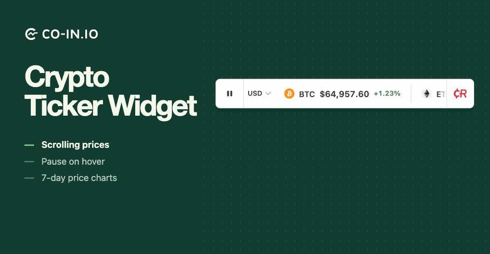

<h1 align="center">CO-IN.IO · Cryptocurrency Widgets</h1>

<p align="center"><strong>Live crypto prices for the people who read your site. Since 2018.</strong></p>

<p align="center">
  <a href="https://co-in.io/crypto-price-widget/"></a>
  <a href="https://co-in.io/crypto-ticker-widget/"></a>
</p>

<p align="center">
  🌍 14 languages &nbsp;·&nbsp; 📦 <a href="https://wordpress.org/plugins/cryptocurrency-price-widget/advanced/">20,000+ WordPress plugin downloads</a> &nbsp;·&nbsp; 🏷️ <a href="CHANGELOG.md">Widget core 1.5.0</a>
</p>

Writing about Ethereum? Give readers the price right beside the story. Running a news site? Let the market scroll across the masthead. **Both widgets are free. No registration or API key required.** Pick a design, change the coins and colors in the live preview, then paste one snippet into your page.

## 📊 The price list

A two-coin watchlist fits beside a post. A detailed table gives a market roundup room for more. Readers can switch from dollars to euros in place, so the numbers make sense in the currency they use.

[](https://co-in.io/crypto-price-widget/)

## 🎞️ The scrolling ticker

Give prices a strip of their own. Tuck the ticker between stories or pin it above the headlines. Readers can pause on a coin and open its details. You choose the pace, direction and colors.

[](https://co-in.io/crypto-ticker-widget/)

## 💡 Borrow a layout

| On your site | A good starting point |
| --- | --- |
| ✍️ **A personal finance blog** | Put BTC and ETH beside your latest post. The [compact sidebar watchlist](https://co-in.io/crypto-price-widget/#preset-sidebar) leaves the article itself free for reading. |
| 📰 **A crypto newsroom** | Keep four market prices above the headlines as readers scroll. Try the [dark news ticker](https://co-in.io/crypto-ticker-widget/#preset-news). |
| 🪙 **A stablecoin explainer** | Show USDT and USDC together so readers can compare their current prices in USD or EUR. Start with the [stablecoin table](https://co-in.io/crypto-price-widget/#preset-stablecoins). |
| 📱 **A mobile market page** | Keep BTC and ETH in view while a reader moves down the page. The [bottom-edge ticker](https://co-in.io/crypto-ticker-widget/#preset-mobile) keeps the header clear. |

Open a preset and make it yours in the builder. When the preview looks right, **copy the embed code** into an HTML block that accepts JavaScript. [View the example source](examples.html). To try both widgets together, download the repository and open `examples.html` in your browser.

## 🔌 At home in WordPress

Install **Cryptocurrency Price Widget**, add its block to a post, and choose your coins right in the editor. If you use the classic editor, the plugin also gives you a shortcode.

[](https://wordpress.org/plugins/cryptocurrency-price-widget/)

## 🗓️ A little project history

Our [first stable release](CHANGELOG.md) shipped on **September 19, 2018**. Today the same project offers two hosted widgets, and its price list is also available through WordPress.org, where the plugin has passed **[20,000 downloads](https://wordpress.org/plugins/cryptocurrency-price-widget/advanced/)**.

## 💬 Tried it on your site?

Tell us where you put it and how it felt to set up. A note like “the ticker fits under my mobile header” helps the next person choose a layout. Sign in on CO-IN.IO to leave a review.

**[⭐ Review the price list](https://co-in.io/reviews/en/price/)** · **[⭐ Review the ticker](https://co-in.io/reviews/en/ticker/)**

Something broken? [Open a GitHub issue](https://github.com/dejurin/Cryptocurrency-Price-Widget/issues) or [email us](mailto:s@co-in.io).

## 🛠️ Under the hood

CO-IN.IO hosts the scripts. Kraken and CoinLore supply crypto prices, MoneyConvert supplies fiat rates, and CryptoCompare supplies USD charts. Coverage varies by coin. The documentation and examples are available under the [MIT license](LICENSE).

<details>
<summary>Price list · copy the HTML example</summary>

Place this snippet inside the page body.

```html
<script>
(function (anchor) {
  var items = "BTC,ETH,LTC";
  var base = "USD,EUR";
  var loader = document.createElement("script");
  loader.src = "https://co-in.io/widget/pricelist.js?items=" + encodeURIComponent(items);
  loader.async = true;
  loader.onload = function () {
    var widget = crCryptocoinPriceWidget.init({
      items: items,
      base: base,
      streaming: "1",
      backgroundColor: "FFFFFF",
      rounded: "1",
      border: "1"
    });
    anchor.parentNode.insertBefore(widget, anchor);
  };
  loader.onerror = function () {
    anchor.insertAdjacentText("beforebegin", "The crypto price widget could not load.");
  };
  anchor.parentNode.insertBefore(loader, anchor);
})(document.currentScript);
</script>
<a href="https://currencyrate.today/">CurrencyRate.Today</a>
```

</details>

<details>
<summary>Scrolling ticker · copy the HTML example</summary>

Place this snippet inside the page body.

```html
<script>
(function (anchor) {
  var items = "BTC,ETH,LTC";
  var base = "USD,EUR";
  var loader = document.createElement("script");
  loader.src = "https://co-in.io/widget/ticker.js?items=" + encodeURIComponent(items) + "&base=" + encodeURIComponent(base);
  loader.async = true;
  loader.onload = function () {
    var widget = crCryptocoinTickerWidget.init({
      items: items,
      base: base,
      streaming: "1",
      position: "inline",
      theme: "auto",
      speed: "normal"
    });
    anchor.parentNode.insertBefore(widget, anchor);
  };
  loader.onerror = function () {
    anchor.insertAdjacentText("beforebegin", "The crypto ticker widget could not load.");
  };
  anchor.parentNode.insertBefore(loader, anchor);
})(document.currentScript);
</script>
<a href="https://currencyrate.today/">CurrencyRate.Today</a>
```

</details>
