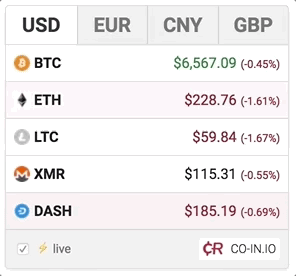

# Cryptocurrency Price Widget

<p align="center">
  Customizable <a href="https://co-in.io/crypto-price-widget/"><strong>Cryptocurrency Price Widget</strong></a> with ⚡ real-time price updates and flexible settings.
</p>

---

<p align="center">
  <a href="https://buymeacoffee.com/deyurii">
    
  </a>
</p>

---



## Why use Cryptocurrency Price Widget?

Cryptocurrency Price Widget is a lightweight embeddable widget written in pure JavaScript. It does not consume your website server resources for market data calculations.

Crypto prices are delivered by public market data providers, while fiat cross-rates are handled separately. The widget is designed to show prices reliably, with minimal requests, no API keys in browser code, and graceful fallback behavior if a provider is temporarily unavailable.

* **[WordPress plugin](https://wordpress.org/plugins/cryptocurrency-price-widget/)**
* [Features](#features)
* [Data sources](#data-sources)
* [Installation](#installation)
* [Options](#options)
* [FAQ](#faq)
* [Video](#video)
* [License](#license)

## Features

* [x] [No cryptojacking](#we-do-not-support-cryptojacking)
* [x] Pure JavaScript, no dependencies
* [x] Flexible settings and customizable design
* [x] Real-time ⚡ streaming price updates
* [x] ≈ **14,280 crypto assets** and **162 fiat currencies**
* [x] Public asset list: [`https://co-in.io/data/crypto-assets.json`](https://co-in.io/data/crypto-assets.json)
* [x] Multilingual support
* [x] SSL support
* [x] SEO-friendly embed output
* [x] WordPress plugin support

## Data sources

The current runtime uses:

* **Crypto prices:** CoinLore public ticker API
* **Fiat cross-rates:** MoneyConvert CDN
* **Widget runtime:** `https://co-in.io/widget/pricelist.js`
* **Supported assets JSON:** `https://co-in.io/data/crypto-assets.json`

The widget focuses on stable price delivery, not provider comparison.

The public asset list currently exposes unique symbol-based crypto assets supported by the widget runtime. Some market data providers may list multiple coins with the same symbol; the widget keeps a canonical symbol-based list for backward compatibility with existing embed codes such as:

```txt
items=BTC,ETH,DOGE
```

## Language support

* English
* Português
* Español
* Deutsch
* Français
* Українська
* Русский

## Installation


[](https://wordpress.org/plugins/cryptocurrency-price-widget/)

Go to the **[website](https://co-in.io/crypto-price-widget/)** to generate a custom widget script.

You can also see **[examples](https://codepen.io/currencyrate_today/pen/dqwXYR)**.

### WordPress plugin

**[Cryptocurrency Price Widget for WordPress](https://wordpress.org/plugins/cryptocurrency-price-widget/)**


## Basic embed example

```html
<!-- Cryptocurrency Price Widget -->
<script>
!function(){
  var scripts = document.getElementsByTagName("script"),
      current = scripts[scripts.length - 1],
      loader = document.createElement("script");

  function render(){
    var widget = crCryptocoinPriceWidget.init({
      base: "USD,EUR,CNY,GBP",
      items: "BTC,ETH,LTC,XMR,DASH",
      backgroundColor: "FFFFFF",
      streaming: "1",
      streamingInterval: "30",
      rounded: "1",
      boxShadow: "1",
      border: "1"
    });

    current.parentNode.insertBefore(widget, current);
  }

  loader.src = "https://co-in.io/widget/pricelist.js?items=BTC%2CETH%2CLTC%2CXMR%2CDASH";
  loader.async = true;
  loader.onload = render;

  current.parentNode.insertBefore(loader, null);
}();
</script>
<!-- /Cryptocurrency Price Widget -->
```

## Options

* **Select horizontal** — fiat currencies by default, but crypto assets can also be selected
* **Select vertical** — crypto assets by default, but fiat currencies can also be selected
* **Color** — widget background color
* **Streaming data** — prices update automatically in real time
* **Striped** — striped rows
* **Rounded** — rounded widget corners
* **Shadow** — widget shadow
* **Border** — widget border
* **Widget script** — ready-to-use embed code

## FAQ

### How do I make the widget fixed width?

Wrap the widget script in a container with a fixed width.

Example:

```html
<div style="width: 320px;">
  <!-- Insert widget script here -->
</div>
```

Try to keep the width at least `220px`.

### Will it slow down my site?

No. Your WordPress server or website backend does not perform market data calculations. The widget is loaded as a client-side JavaScript embed, and market data is delivered by external market data providers.

### Do I need an API key?

No. The public widget runtime does not require you to add an API key.

### What happens if a provider is temporarily unavailable?

The widget is designed to fail gracefully. It uses request timeouts and fallback behavior instead of blocking your page.

## We do not support cryptojacking

**What is cryptojacking?** Cryptojacking is the unauthorized use of a visitor’s device CPU power to mine cryptocurrencies.

There are cases on the Internet where installing a script or widget causes a computer to start mining. Cryptocurrency Price Widget does not support cryptojacking.

You can inspect the website and JavaScript code yourself.

Tools for checking:

* [Check browser](https://cryptojackingtest.com/)
* [Magento malware scanner](https://github.com/gwillem/magento-malware-scanner)

## Video

[](http://www.youtube.com/watch?v=nz_HdajmqPU)

## Support

If you need help or have other issues, contact: [s@co-in.io](mailto:s@co-in.io)

## License

This widget is distributed under the [MIT](https://choosealicense.com/licenses/mit/) license.

You can use this widget for free on your websites. Since we handle the infrastructure and maintain the public widget runtime, please keep the backlink in the widget.

---

Powered by [CO-IN.IO](https://co-in.io/)
